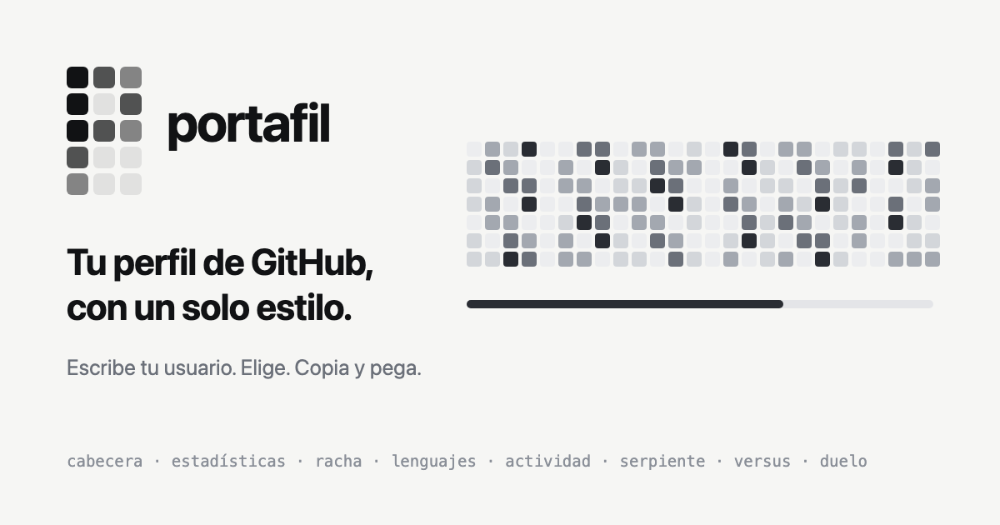

<p align="center">
  
</p>

<p align="center"><b>English</b> · <a href="README.md">Español</a></p>

# Portafil

**One style for your whole GitHub profile.** Header, stats, streak, languages, activity, the snake that eats your commits, versus and duels against other profiles: every piece shares theme, type and sizes, so your profile looks like one design instead of a collage of widgets.

Type your username on the web, pick what you like and copy the code. No YAML, nothing to configure. GitHub runs no JavaScript in a README, so every piece is an SVG with CSS animation served from a URL.

<p align="center"><a href="https://perfila-lr.vercel.app"><b>Try it with your username →</b></a> · <a href="https://perfila-lr.vercel.app/play.html">Studio</a> · <a href="#github-action">GitHub Action</a></p>

## What it looks like

<p align="center">
  <a href="https://perfila-lr.vercel.app/?u=luisrodriguez-rgb">
    <picture>
      <source media="(prefers-color-scheme: dark)" srcset="https://perfila-lr.vercel.app/api/kit/luisrodriguez-rgb.svg?theme=ink">
      
    </picture>
  </a>
</p>
<p align="center">
  <picture>
    <source media="(prefers-color-scheme: dark)" srcset="https://perfila-lr.vercel.app/api/luisrodriguez-rgb.svg?game=pacman&theme=ink">
    
  </picture>
</p>

That is @luisrodriguez-rgb real data served live, light or dark to match your GitHub: exactly what your profile will show.

### In three steps

1. Open [perfila-lr.vercel.app](https://perfila-lr.vercel.app) and type your GitHub username.
2. Pick the style and the pieces (or a profile template).
3. Press **«Open my README on GitHub»**: the code is copied, or already written if you have no README yet. Press «Commit changes» and you are done.

## Pieces

| Piece | URL | Shows |
| --- | --- | --- |
| Header | `/api/header/<user>.svg` | Avatar, name, bio, followers, repos, stars and active days |
| Stats | `/api/stats/<user>.svg` | Contributions, commits, PRs, issues, reviews and stars in the last year |
| Streak | `/api/streak/<user>.svg` | Current streak, longest and the last 30 days |
| Languages | `/api/langs/<user>.svg` | Languages by code size in your public repos |
| Activity | `/api/activity/<user>.svg` | Contributions per week, 53 weeks |
| All in one | `/api/kit/<user>.svg` | The five above in a single image |
| Snake | `/api/<user>.svg` | An AI (BFS + Flood Fill) eats your contribution graph |
| Game of Life | `/api/<user>.svg?game=life` | Your contributions evolve with Conway's rules |
| Pac-Man | `/api/<user>.svg?game=pacman` | Pac-Man eats your graph while two ghosts chase it |
| Invaders | `/api/<user>.svg?game=invaders` | A ship shoots your contributions, column by column |
| Tetris | `/api/<user>.svg?game=tetris` | Your year falls toward the past and pieces complete weeks |
| Versus | `/api/versus/<a>-vs-<b>.svg` | Your numbers next to another profile's |
| Duel | `/api/duel/<a>-vs-<b>.svg` | The same AI on both graphs, with the score; the `/duel/<a>-vs-<b>` page is for sharing and challenging |

All of them take `theme` (`ink`, `paper`, `dark`, `light`, `cyberpunk`, `neon_cyan`, `amber_terminal`) and `lang` (`en`, `es`). The snake also takes `morph`, `speed`, `pause` and `mood`: with `mood=auto` (the default) it sleeps after a week without contributions and shows off your streak once it passes 7 days. The full contract is in [docs/contract.md](docs/contract.md) and a ready-to-copy template in [docs/profile_readme_template.md](docs/profile_readme_template.md).

## Sharing outside GitHub

`/api/og/<user>.png` is your 1200×630 card for LinkedIn or X, and `/u/<user>` is the link that shows it when shared. Duels have their own at `/api/og/duel/<a>-vs-<b>.png`. The web also has profile templates with text (developer, student, maintainer) and a preview of the README as it will look on GitHub.

## Studio

`/play.html` is the playable side: the live snake, manual mode, duel against the AI, real-time duels between profiles, the four game modes (played by the AI or by you), Commit Art and video clips for X, LinkedIn, Reels or TikTok.

## GitHub Action

If you would rather not depend on the server, the Action generates the snake in your own repository:

```yaml
- uses: luisrodriguez-rgb/portafil@v1
  with:
    github_user_name: your-user
    outputs: |
      dist/portafil-snake.svg?theme=paper
      dist/portafil-snake-dark.svg?theme=ink
```

## Development

Node 20 or later. A single dependency, `@resvg/resvg-js`, turns the social cards into PNG (`npm install`); their font, JetBrains Mono, is in `assets/fonts` with its OFL license.

```bash
npm run dev
```

Serves the web and the API at `http://localhost:3000` (or the next free port if that one is busy) with real GitHub data. Without a token it uses the public APIs (profile, calendar, followers and stars exact; commits, PRs and languages approximate, and the web says so).

With a token, same as production. Create a *fine-grained* token with no permissions at [github.com/settings/personal-access-tokens](https://github.com/settings/personal-access-tokens) (it only reads public data) and pass it like this, replacing `ghp_xxx` with yours:

```bash
GITHUB_TOKEN=ghp_xxx npm run dev
```

`npm run dev:fixture` uses made-up test data without network (the visual tests use it); the web says so too.

```bash
npm test
```

`npm run smoke` opens the home page and the studio in headless Chrome, with test data and the security headers from `vercel.json`, and checks that they render (Chrome path via `CHROME=...`).

Deployment: Vercel serves the web and the API together; it needs the `GITHUB_TOKEN` variable (a token with no scopes is enough). The public domain and repository are set in `shared/brand.js`.

For heavy traffic (`server/cache.js`):

- `GITHUB_TOKEN` accepts several comma-separated tokens: the one with the most requests left is used. When all of them have fewer than 500 left in the hour, data is considered fresh for 6 h instead of 30 min.
- With `KV_REST_API_URL` and `KV_REST_API_TOKEN` (Vercel KV or Upstash Redis) the cache is shared across instances.
- If GitHub fails, the last good data up to 24 h old is served instead of an error.

## Docs (Spanish)

- [Brand: name, logo, color and tone](docs/BRAND.md)
- [Plan and phases](docs/roadmap/PLAN.md)
- [URL contract](docs/contract.md)
- [Metrics](docs/metrics.md)
- [Example profiles by style](examples/README.md)
- [Launch: lists, Marketplace, article and posts](docs/launch/README.md)

Portafil grows out of the GITHUB_SNAKE.EXE engine, by the same author.
