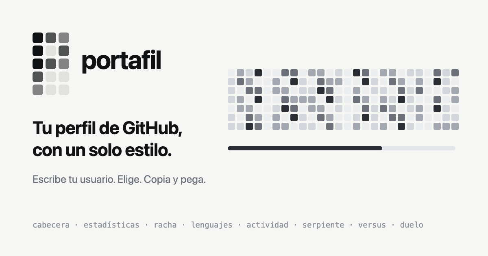

<p align="center">
  
</p>

<p align="center"><b>English</b> · <a href="README.md">Español</a></p>

<p align="center">
  <a href="https://github.com/luisrodriguez-rgb/portafil/stargazers"></a>
  <a href="https://perfila-lr.vercel.app"></a>
  <a href="#github-action"></a>
  <a href="LICENSE"></a>
</p>

# Portafil

**One style for your whole GitHub profile. And one that looks like nobody else's.**

Most GitHub profiles look the same: a card from one tool, another from another, the green snake and a row of badges. Portafil builds every piece of your profile with **one visual system** (theme, type and sizes) and adds pieces that **only exist here**: your year as a fingerprint, your year in review with your style, and your contribution graph turned into Pac-Man, Tetris or the Game of Life.

Type your username, pick what you like and copy the code. No YAML, nothing to configure. GitHub runs no JavaScript in a README, so every piece is an SVG with CSS animation served from a URL, with your real data and always up to date.

<p align="center"><a href="https://perfila-lr.vercel.app"><b>Try it with your username →</b></a> · <a href="https://perfila-lr.vercel.app/play.html">Studio</a> · <a href="#github-action">GitHub Action</a></p>

## What it looks like

<p align="center">
  <a href="https://perfila-lr.vercel.app/?u=luisrodriguez-rgb">
    <picture>
      <source media="(prefers-color-scheme: dark)" srcset="https://perfila-lr.vercel.app/api/kit/luisrodriguez-rgb.svg?theme=ink">
      
    </picture>
  </a>
</p>

That is [@luisrodriguez-rgb](https://github.com/luisrodriguez-rgb) real data served live, light or dark to match your GitHub: exactly what your profile will show.

### In three steps

1. Open [perfila-lr.vercel.app](https://perfila-lr.vercel.app) and type your GitHub username.
2. Pick the style and the pieces (or a profile template). Every piece can have its own style.
3. Press **«Open my README on GitHub»**: the code is copied, or already written if you have no README yet. Press «Commit changes» and you are done.

**Like it?** Give the repository a ⭐: it helps more people find it. And if you already use it, [show your profile](https://github.com/luisrodriguez-rgb/portafil/issues/new?template=3-mi-perfil.yml) to be featured here.

## Only on Portafil

**Your fingerprint.** Your year as a circle: 53 weeks around and the 7 days as rings. No two are alike. Next to it, your favorite day, best month, longest streak, consistency and weekly rhythm.

<p align="center">
  
</p>

**Your year.** The calendar-year review to share in December: your total against the same period last year, your best moments, your project of the year and **your style**, a label based on how you contribute («Clockwork», «Weekend warrior», «On the rise»...). In January it shows the whole previous year.

<p align="center">
  
</p>

**Your graph, playable.** The AI snake, Pac-Man, invaders, Tetris and the Game of Life play on your real contributions, animated in an SVG under 120 KB.

<p align="center">
  
</p>

## Styles

Nine themes designed as one system: every piece changes together. The neutral and green ones **follow GitHub light or dark mode**; the color ones **always look the same**, so your profile is recognizable from afar.

| Theme | Key | Character | Light and dark |
| --- | --- | --- | --- |
| Ink | `ink` | Charcoal grey, the default | Pairs with Paper |
| Paper | `paper` | Clean white, dark ink | Pairs with Ink |
| Phosphor | `dark` | Terminal green on black | Pairs with GitHub light |
| GitHub light | `light` | GitHub's familiar greens | Pairs with Phosphor |
| Sand | `sand` | Warm beige with terracotta | Pairs with Amber |
| Cyberpunk | `cyberpunk` | Magenta and cyan on dark violet | Always the same |
| Cyan | `neon_cyan` | Blue neon on night blue | Always the same |
| Amber | `amber_terminal` | Amber phosphor monitor | Always the same |
| Ruby | `ruby` | Deep red on near black | Always the same |

On the web, **every piece can have its own style**: the header in Ink, the streak in Phosphor, your fingerprint in Ruby... The README code and the preview follow each piece's theme in each mode. There is a full example profile per style in [examples/](examples/README.md).

## Pieces

**Your profile**

| Piece | URL | Shows |
| --- | --- | --- |
| Header | `/api/header/<user>.svg` | Avatar, name, bio, followers, own repos, stars and active days |
| Stats | `/api/stats/<user>.svg` | Contributions, commits, PRs, issues, reviews and stars in the last year |
| Streak | `/api/streak/<user>.svg` | Current and longest streak, and the last 30 days |
| Languages | `/api/langs/<user>.svg` | Languages by code size in your public repos, no forks |
| Activity | `/api/activity/<user>.svg` | Contributions per week, 53 weeks |
| Your fingerprint | `/api/fingerprint/<user>.svg` | Your year as a circle, with favorite day, best month, streak, consistency and weekly rhythm |
| Your year | `/api/year/<user>.svg` | Calendar-year review: comparison, your style, best moments, project of the year and the year month by month |
| All in one | `/api/kit/<user>.svg` | Header, stats, streak, languages and activity in a single image |

**Games**

| Piece | URL | Shows |
| --- | --- | --- |
| Snake | `/api/<user>.svg` | An AI (BFS + Flood Fill) eats your graph; it sleeps after a week without contributions and shows off your streak |
| Game of Life | `/api/<user>.svg?game=life` | Your busiest days evolve under Conway's rules |
| Pac-Man | `/api/<user>.svg?game=pacman` | Pac-Man eats your graph while two ghosts chase it |
| Invaders | `/api/<user>.svg?game=invaders` | A ship shoots at your contributions, column by column |
| Tetris | `/api/<user>.svg?game=tetris` | Your year falls toward the past and pieces complete weeks |

**Against another profile**

| Piece | URL | Shows |
| --- | --- | --- |
| Versus | `/api/versus/<a>-vs-<b>.svg` | Your numbers next to another profile's |
| Duel | `/api/duel/<a>-vs-<b>.svg` | The same AI on both graphs, with a scoreboard; the `/duel/<a>-vs-<b>` page is for sharing and challenging |

All of them take `theme` (`ink`, `paper`, `dark`, `light`, `cyberpunk`, `neon_cyan`, `amber_terminal`, `ruby`, `sand`) and `lang` (`en`, `es`). The snake also takes `morph`, `speed`, `pause` and `mood`. They refresh on their own during the day, at most about 2 hours behind. The full contract is in [docs/contract.md](docs/contract.md) and a ready-to-copy template in [docs/profile_readme_template.md](docs/profile_readme_template.md).

## Sharing outside GitHub

X, LinkedIn or Instagram don't show SVG, so the most shareable pieces have a 1200×630 PNG, with the brand and the link to make yours:

| Image | URL |
| --- | --- |
| Your profile | `/api/og/<user>.png` |
| Your year | `/api/og/year/<user>.png` |
| Your fingerprint | `/api/og/fingerprint/<user>.png` |
| A duel | `/api/og/duel/<a>-vs-<b>.png` |

When you share the `/u/<user>` link, the social preview is your card; with `/u/<user>?p=year` or `?p=fingerprint`, your year or your fingerprint. On the web, «Your year» and «Your fingerprint» have a **«PNG for social»** button.

## Studio

[`/play.html`](https://perfila-lr.vercel.app/play.html) is the playable side: the live snake, manual mode, a duel against the AI, real-time duels between profiles, the four game modes (played by the AI or by you) and Commit Art.

And the **social clips**, vertical (Reels, TikTok, Shorts), square or landscape, rendered in your browser:

- **My profile:** the snake or the game you are playing, on your graph.
- **My year:** your GitHub «Wrapped» in 13 seconds: counter, your year's calendar, your best moments and your style, with the post text already written.
- **Last duel:** the duel between two profiles, with its winner.

«Download SVG» also exports the mode you are playing.

## GitHub Action

If you'd rather not depend on the server, the Action generates the SVGs in your own repository, every day:

```yaml
- uses: luisrodriguez-rgb/portafil@v1
  with:
    github_user_name: your-username
    outputs: |
      dist/portafil-snake.svg?theme=paper
      dist/portafil-snake-dark.svg?theme=ink
      dist/portafil-pacman.svg?game=pacman&theme=ruby
```

## Feedback

Bugs, ideas or pieces you miss: [open an issue](https://github.com/luisrodriguez-rgb/portafil/issues/new/choose) with the templates. The web also asks, in one click and without personal data, whether it was easy.

## Development

Node 20 or later. A single dependency, `@resvg/resvg-js`, turns the social cards into PNG (`npm install`); their font, JetBrains Mono, is in `assets/fonts` with its OFL license.

```bash
npm run dev
```

Serves the web and the API at `http://localhost:3000` (or the next free port if that one is busy) with real GitHub data. Without a token it uses the public APIs (profile, calendar, followers and stars exact; commits, PRs and languages approximate, and the web says so).

With a token, same as production. Create a *fine-grained* token with no permissions at [github.com/settings/personal-access-tokens](https://github.com/settings/personal-access-tokens) (it only reads public data) and pass it like this, replacing `ghp_xxx` with yours:

```bash
GITHUB_TOKEN=ghp_xxx npm run dev
```

`npm run dev:fixture` uses made-up test data without network (the visual tests use it); the web says so too.

```bash
npm test
```

`npm run smoke` opens the home page and the studio in headless Chrome, with test data and the security headers from `vercel.json`, and checks that they render (Chrome path via `CHROME=...`). `npm run check:deploy` checks production route by route; the [Monitor](.github/workflows/monitor.yml) workflow runs it every 30 minutes and alerts if something fails.

| Folder | Contents |
| --- | --- |
| `index.html`, `css/site.css`, `js/site.js` | The web: home page, username field and piece gallery |
| `play.html`, `css/studio.css`, `js/` | The studio and the engine (snake, pathfinding, games, SVG exporter, duel, video) |
| `shared/` | Shared by web, API and Action: brand, design tokens, games, contract, README code |
| `server/`, `api/` | Vercel functions: snake, pieces, your year, duel, calendar and social cards |
| `action/` | GitHub Action |
| `tests/` | Tests, including visual fingerprints of every SVG per theme |
| `docs/` | Brand, plan, contract, metrics and launch (in Spanish) |

Deployment: Vercel serves the web and the API together; it needs the `GITHUB_TOKEN` variable (a token with no scopes is enough). The public domain and repository are set in `shared/brand.js`.

For heavy traffic (`server/cache.js`):

- `GITHUB_TOKEN` accepts several comma-separated tokens: the one with the most requests left is used. When all of them have fewer than 500 left in the hour, data is considered fresh for 6 h instead of 30 min.
- With `KV_REST_API_URL` and `KV_REST_API_TOKEN` (Vercel KV or Upstash Redis) the cache is shared across instances.
- If GitHub fails, the last good data up to 24 h old is served instead of an error.

## Docs (Spanish)

- [Brand: name, logo, color and tone](docs/BRAND.md)
- [Plan and phases](docs/roadmap/PLAN.md)
- [URL contract](docs/contract.md)
- [Metrics](docs/metrics.md)
- [Example profiles by style](examples/README.md)
- [Launch: lists, Marketplace, article and posts](docs/launch/README.md)

Portafil grows out of the GITHUB_SNAKE.EXE engine, by the same author.
