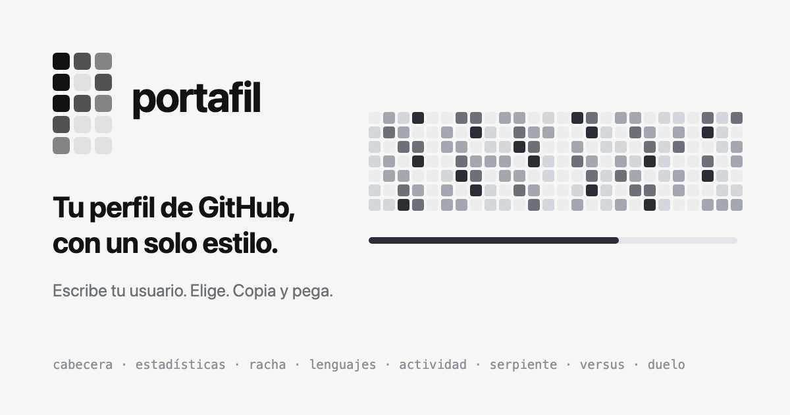

<p align="center">
  
</p>

<p align="center"><a href="README.en.md">English</a> · <b>Español</b></p>

<p align="center">
  <a href="https://github.com/luisrodriguez-rgb/portafil/stargazers"></a>
  <a href="https://perfila-lr.vercel.app"></a>
  <a href="#github-action"></a>
  <a href="LICENSE"></a>
</p>

# Portafil

**Tu perfil de GitHub, con un solo estilo. Y que no se parezca al de nadie.**

Casi todos los perfiles de GitHub se ven iguales: una tarjeta de una herramienta, otra de otra, la serpiente verde y una fila de insignias. Portafil genera todas las piezas de tu perfil con **un mismo sistema visual** (tema, tipografía y medidas) y añade piezas que **solo existen aquí**: tu año como una huella dactilar, tu resumen del año con tu estilo, y tu gráfico de contribuciones convertido en Pac-Man, Tetris o el juego de la vida.

Escribe tu usuario, elige lo que quieras y copia el código. Sin YAML y sin configurar nada. GitHub no ejecuta JavaScript en un README, así que cada pieza es un SVG con animación CSS servido desde una URL, con tus datos reales y siempre al día.

<p align="center"><a href="https://perfila-lr.vercel.app"><b>Pruébalo con tu usuario →</b></a> · <a href="https://perfila-lr.vercel.app/play.html">Estudio</a> · <a href="#github-action">GitHub Action</a></p>

## Así queda

<p align="center">
  <a href="https://perfila-lr.vercel.app/?u=luisrodriguez-rgb">
    <picture>
      <source media="(prefers-color-scheme: dark)" srcset="https://perfila-lr.vercel.app/api/kit/luisrodriguez-rgb.svg?theme=ink&lang=es">
      
    </picture>
  </a>
</p>

Son los datos reales de [@luisrodriguez-rgb](https://github.com/luisrodriguez-rgb) servidos en vivo, en claro u oscuro según tu GitHub: exactamente lo que verá tu perfil.

### En tres pasos

1. Abre [perfila-lr.vercel.app](https://perfila-lr.vercel.app) y escribe tu usuario de GitHub.
2. Elige el estilo y las piezas (o una plantilla de perfil). Cada pieza puede llevar su propio estilo.
3. Pulsa **«Abrir mi README en GitHub»**: el código va copiado, o ya escrito si aún no tienes README. Pulsa «Commit changes» y listo.

**¿Te gusta?** Dale una ⭐ al repositorio: ayuda a que más gente lo encuentre. Y si ya lo usas, [enseña tu perfil](https://github.com/luisrodriguez-rgb/portafil/issues/new?template=3-mi-perfil.yml) para salir aquí como ejemplo.

## Lo que solo tiene Portafil

**Tu huella.** Tu año en un círculo: las 53 semanas alrededor y los 7 días como anillos. No hay dos iguales. Al lado, tu día favorito, tu mes más activo, tu racha más larga, tu constancia y tu ritmo semanal.

<p align="center">
  
</p>

**Tu año.** El resumen del año natural para compartir en diciembre: el total frente al mismo periodo del año anterior, tus mejores momentos, tu proyecto del año y **tu estilo**, una etiqueta según cómo contribuyes («Constante como un reloj», «Guerrero de fin de semana», «En pleno despegue»...). En enero muestra el año anterior completo.

<p align="center">
  
</p>

**Tu gráfico, jugable.** La serpiente con IA, Pac-Man, invasores, Tetris y el juego de la vida juegan sobre tus contribuciones reales, animados en un SVG de menos de 120 KB.

<p align="center">
  
</p>

## Estilos

Nueve temas diseñados como un sistema: todas las piezas cambian juntas. Los neutros y los verdes **cambian con el modo claro u oscuro de GitHub**; los de color **se ven siempre igual**, para que tu perfil se reconozca de lejos.

| Tema | Clave | Carácter | En claro y oscuro |
| --- | --- | --- | --- |
| Tinta | `ink` | Gris carbón, el tema por defecto | Pareja con Papel |
| Papel | `paper` | Blanco limpio, tinta oscura | Pareja con Tinta |
| Fósforo | `dark` | Verde terminal sobre negro | Pareja con GitHub claro |
| GitHub claro | `light` | Los verdes de siempre de GitHub | Pareja con Fósforo |
| Arena | `sand` | Beige cálido con terracota | Pareja con Ámbar |
| Cyberpunk | `cyberpunk` | Magenta y cian sobre violeta oscuro | Siempre igual |
| Cian | `neon_cyan` | Neón azul sobre azul noche | Siempre igual |
| Ámbar | `amber_terminal` | Monitor de fósforo ámbar | Siempre igual |
| Rubí | `ruby` | Rojo intenso sobre casi negro | Siempre igual |

En la web, **cada pieza puede llevar su propio estilo**: la cabecera en Tinta, la racha en Fósforo, tu huella en Rubí... El código del README y la vista previa respetan el tema de cada una en cada modo. Hay un perfil de ejemplo completo por estilo en [examples/](examples/README.md).

## Piezas

**Tu perfil**

| Pieza | URL | Muestra |
| --- | --- | --- |
| Cabecera | `/api/header/<usuario>.svg` | Avatar, nombre, bio, seguidores, repos propios, estrellas y días activos |
| Estadísticas | `/api/stats/<usuario>.svg` | Contribuciones, commits, PRs, issues, reviews y estrellas del último año |
| Racha | `/api/streak/<usuario>.svg` | Racha actual, la más larga y los últimos 30 días |
| Lenguajes | `/api/langs/<usuario>.svg` | Lenguajes por tamaño de código en tus repos públicos, sin forks |
| Actividad | `/api/activity/<usuario>.svg` | Contribuciones por semana, 53 semanas |
| Tu huella | `/api/fingerprint/<usuario>.svg` | Tu año en un círculo, con día favorito, mes más activo, racha, constancia y ritmo semanal |
| Tu año | `/api/year/<usuario>.svg` | Resumen del año natural: comparación, tu estilo, momentos, proyecto del año y el año mes a mes |
| Todo en una | `/api/kit/<usuario>.svg` | Cabecera, estadísticas, racha, lenguajes y actividad en una sola imagen |

**Juegos**

| Pieza | URL | Muestra |
| --- | --- | --- |
| Serpiente | `/api/<usuario>.svg` | Una IA (BFS + Flood Fill) se come tu gráfico; duerme si llevas una semana sin contribuir y presume de tu racha |
| Juego de la vida | `/api/<usuario>.svg?game=life` | Tus días más intensos evolucionan con las reglas de Conway |
| Pac-Man | `/api/<usuario>.svg?game=pacman` | Pac-Man se come tu gráfico mientras dos fantasmas lo persiguen |
| Invasores | `/api/<usuario>.svg?game=invaders` | Una nave dispara a tus contribuciones, columna a columna |
| Tetris | `/api/<usuario>.svg?game=tetris` | Tu año cae hacia el pasado y las piezas completan semanas |

**Frente a otro perfil**

| Pieza | URL | Muestra |
| --- | --- | --- |
| Versus | `/api/versus/<a>-vs-<b>.svg` | Tus cifras frente a las de otro perfil |
| Duelo | `/api/duel/<a>-vs-<b>.svg` | La misma IA en los dos gráficos, con marcador; la página `/duel/<a>-vs-<b>` sirve para compartir y retar |

Todas aceptan `theme` (`ink`, `paper`, `dark`, `light`, `cyberpunk`, `neon_cyan`, `amber_terminal`, `ruby`, `sand`) y `lang` (`en`, `es`). La serpiente además acepta `morph`, `speed`, `pause` y `mood`. Se actualizan solas a lo largo del día, con unas 2 horas de retraso como mucho. El contrato completo está en [docs/contract.md](docs/contract.md) y una plantilla lista para copiar en [docs/profile_readme_template.md](docs/profile_readme_template.md).

## Para compartir fuera de GitHub

X, LinkedIn o Instagram no muestran SVG, así que las piezas más compartibles tienen versión PNG de 1200×630, con la marca y el enlace para hacer la tuya:

| Imagen | URL |
| --- | --- |
| Tu perfil | `/api/og/<usuario>.png` |
| Tu año | `/api/og/year/<usuario>.png` |
| Tu huella | `/api/og/fingerprint/<usuario>.png` |
| Un duelo | `/api/og/duel/<a>-vs-<b>.png` |

Al compartir el enlace `/u/<usuario>`, la vista previa en redes es tu tarjeta; con `/u/<usuario>?p=year` o `?p=fingerprint`, la de tu año o tu huella. En la web, «Tu año» y «Tu huella» tienen un botón **«PNG para redes»**.

## Estudio

En [`/play.html`](https://perfila-lr.vercel.app/play.html) está el lado jugable: la serpiente en vivo, modo manual, duelo contra la IA, duelos entre perfiles en tiempo real, los cuatro modos de juego (los juega la IA o tú) y Commit Art.

Y los **clips para redes**, en vertical (Reels, TikTok, Shorts), cuadrado u horizontal, generados en tu navegador:

- **Mi perfil:** la serpiente o el juego que estés jugando, sobre tu gráfico.
- **Mi año:** tu «Wrapped» de GitHub en 13 segundos: contador, tu calendario del año, tus mejores momentos y tu estilo, con el texto para publicar ya escrito.
- **Último duelo:** el duelo entre dos perfiles, con ganador.

«Descargar SVG» también exporta el modo que estés jugando.

## GitHub Action

Si prefieres no depender del servidor, la Action genera los SVG en tu propio repositorio, cada día:

```yaml
- uses: luisrodriguez-rgb/portafil@v1
  with:
    github_user_name: tu-usuario
    outputs: |
      dist/portafil-snake.svg?theme=paper
      dist/portafil-snake-dark.svg?theme=ink
      dist/portafil-pacman.svg?game=pacman&theme=ruby
```

## Opiniones

Errores, ideas o piezas que echas de menos: [abre una issue](https://github.com/luisrodriguez-rgb/portafil/issues/new/choose) con las plantillas. La web también pregunta, en un clic y sin datos personales, si te resultó fácil.

## Desarrollo

Node 20 o superior. Una sola dependencia, `@resvg/resvg-js`, para convertir las tarjetas para redes a PNG (`npm install`); la fuente que usan, JetBrains Mono, está en `assets/fonts` con su licencia OFL.

```bash
npm run dev
```

Levanta la web y la API en `http://localhost:3000` (o el siguiente puerto libre, si ese está ocupado) con datos reales de GitHub. Sin token usa las API públicas (perfil, calendario, seguidores y estrellas exactos; commits, PRs y lenguajes aproximados, y la web lo avisa).

Con token, igual que en producción. Crea uno *fine-grained* sin ningún permiso en [github.com/settings/personal-access-tokens](https://github.com/settings/personal-access-tokens) (solo lee datos públicos) y pásalo así, sustituyendo `ghp_xxx` por el tuyo:

```bash
GITHUB_TOKEN=ghp_xxx npm run dev
```

`npm run dev:fixture` usa datos de prueba inventados, sin red (lo usan las pruebas visuales); la web también lo avisa.

```bash
npm test
```

`npm run smoke` abre la portada y el estudio en Chrome sin ventana, con datos de prueba y las cabeceras de seguridad de `vercel.json`, y comprueba que se pintan (ruta de Chrome con `CHROME=...`). `npm run check:deploy` comprueba producción ruta a ruta; el workflow [Monitor](.github/workflows/monitor.yml) lo ejecuta cada 30 minutos y avisa si algo falla.

| Carpeta | Qué hay |
| --- | --- |
| `index.html`, `css/site.css`, `js/site.js` | La web: portada, campo de usuario y galería de piezas |
| `play.html`, `css/studio.css`, `js/` | El estudio y el motor (serpiente, pathfinding, juegos, exportador SVG, duelo, vídeo) |
| `shared/` | Lo que comparten web, API y Action: marca, design tokens, juegos, contrato, código para el README |
| `server/`, `api/` | Funciones de Vercel: serpiente, piezas, tu año, duelo, calendario y tarjetas para redes |
| `action/` | GitHub Action |
| `tests/` | Pruebas, incluidas huellas visuales de cada SVG por tema |
| `docs/` | Marca, plan, contrato, métricas y lanzamiento |

Despliegue: Vercel sirve la web y la API juntas; necesita la variable `GITHUB_TOKEN` (un token sin permisos basta). El dominio y el repositorio públicos se configuran en `shared/brand.js`.

Para aguantar mucho tráfico (`server/cache.js`):

- `GITHUB_TOKEN` admite varios tokens separados por comas: se usa el que más consultas le quedan. Cuando a todos les quedan menos de 500 en la hora, los datos se dan por buenos 6 h en lugar de 30 min.
- Con `KV_REST_API_URL` y `KV_REST_API_TOKEN` (Vercel KV o Upstash Redis) la caché se comparte entre instancias.
- Si GitHub falla, se sirve el último dato bueno de hasta 24 h en vez de un error.

## Documentación

- [Marca: nombre, logo, color y tono](docs/BRAND.md)
- [Plan y fases](docs/roadmap/PLAN.md)
- [Contrato de URL](docs/contract.md)
- [Métricas](docs/metrics.md)
- [Perfiles de ejemplo por estilo](examples/README.md)
- [Lanzamiento: listas, Marketplace, artículo y publicaciones](docs/launch/README.md)

Portafil nace del motor de GITHUB_SNAKE.EXE, del mismo autor.
